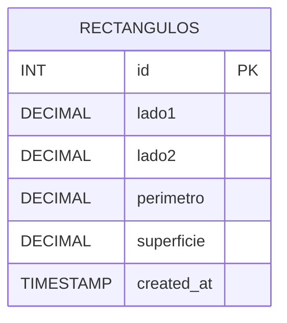

# Ejercicio 1: Rectángulos

## Diagrama Entidad-Relación

## Decisiones de Diseño y Modelado
- **Persistencia en MySQL:** Se utiliza un pool de conexiones con `mysql2/promise` conectado a la base de datos `tp2_programacion_iv`.
- **Cálculo Servidor y Restricción de Entradas:** La API únicamente procesa `lado1` y `lado2` en `POST` y `PUT`. Mediante `express-validator` se rechaza de forma estricta (`400 Bad Request`) si el cliente intenta enviar los campos `perimetro` o `superficie`.
- **Validaciones:** Se exige que ambos lados sean números mayores a cero con `.isFloat({ gt: 0 })` y que los parámetros de ruta (`:id`) sean enteros positivos con `.isInt({ gt: 0 })`.