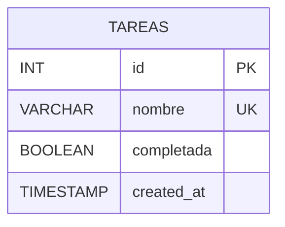

# Ejercicio 2: Tareas

## Diagrama Entidad-Relación

## Decisiones de Diseño y Modelado
- **Criterio de Unicidad:** Se normalizan los nombres mediante `.trim()` y `LOWER()` al consultar duplicados en SQL, asegurando que diferencias de mayúsculas o espacios accidentales no permitan registros repetidos (`409 Conflict`).
- **Filtro de Estados:** Se procesa vía Query Params (`GET /tareas?completada=true|false`). `express-validator` valida con `.isIn(['true', 'false'])` que solo se acepten valores booleanos válidos (`400 Bad Request`).