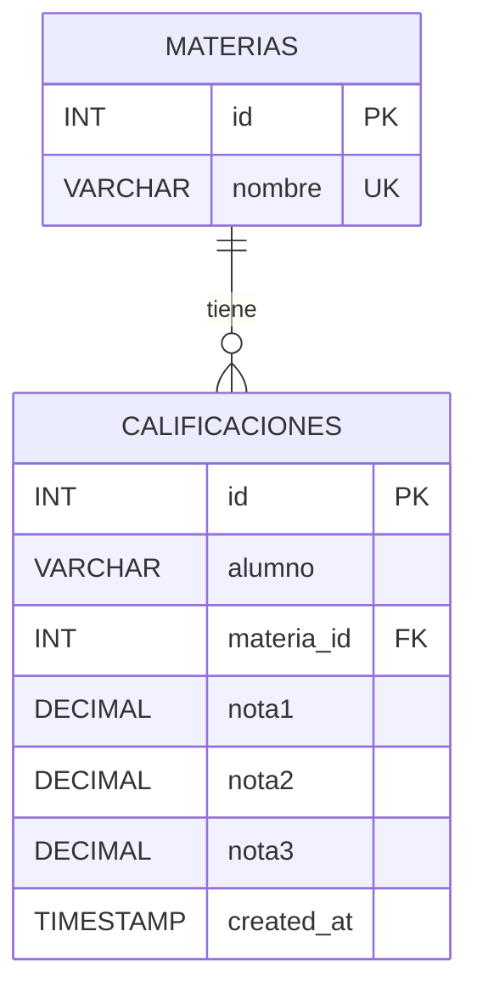

# Ejercicio 3: Calificaciones y Materias

## Diagrama Entidad-Relación

## Decisiones de Diseño y Modelado
- **Relación mediante Clave Foránea:** Las materias se persisten en una tabla independiente (`materias`) y se vinculan a `calificaciones` mediante `materia_id` con restricción de clave foránea (`FOREIGN KEY`)[cite: 37].
- **Criterio de Unicidad:** Se impide registrar más de una vez a un alumno en una misma materia (`UNIQUE (alumno, materia_id)` tanto a nivel base de datos como por validación previa con código `409 Conflict`)[cite: 37].
- **Validación de Calificaciones:** `express-validator` comprueba que el arreglo contenga estrictamente 3 notas (`isArray({ min: 3, max: 3 })`) acotadas numéricamente entre 1 y 10 (`isFloat({ min: 1, max: 10 })`)[cite: 37].
- **Consultas con JOIN:** El endpoint `GET /calificaciones` realiza un `INNER JOIN` para incorporar el nombre de la materia y computa el promedio en el servidor redondeado a 2 decimales[cite: 37].